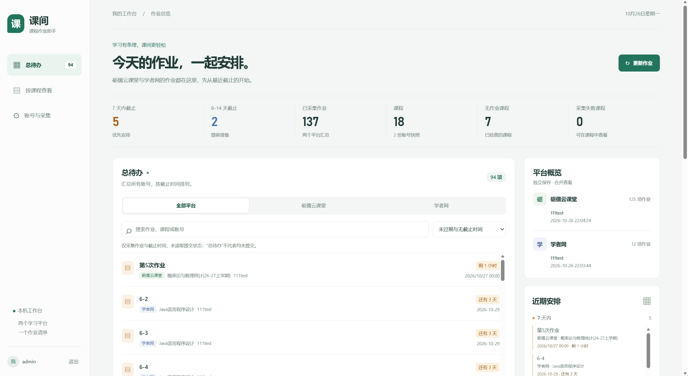
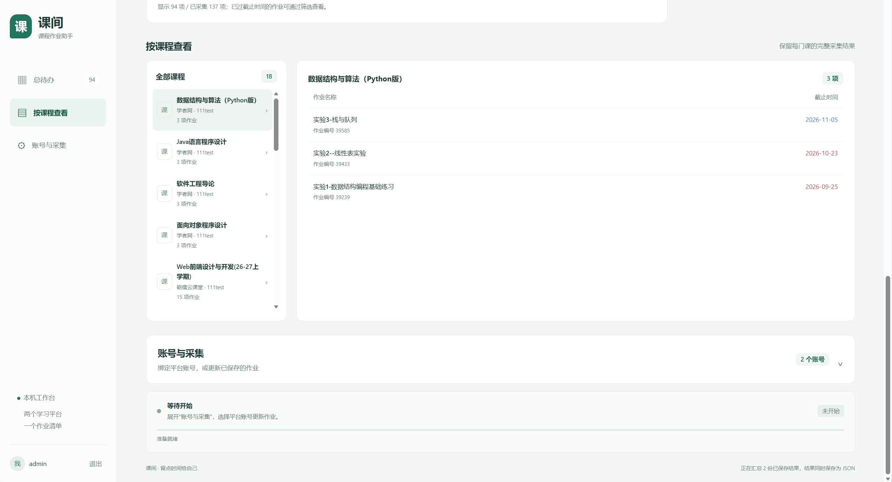

# Moodle 作业工作台

一个本机运行的作业采集与待办看板。后端使用 Java 17、Spring Boot、MySQL 和 Playwright；前端使用原生 HTML、CSS 和 JavaScript，无需 Node.js。当前支持砺儒云课堂（Moodle）和学者网。

首页将已采集作业合并到“总待办”，可以按平台、关键词和截止时间筛选。页面也会显示平台、课程、采集账号和最近一次采集状态。应用不会读取作业提交记录，因此列表不能判断作业是否已经提交。

## 界面预览





## 环境要求

- Windows，安装 JDK 17。
- MySQL，且运行应用的数据库账号有权创建和修改项目所需的表。
- 安装 Microsoft Edge。采集由 Playwright 启动独立的 Edge 会话，不使用日常浏览器的 Cookie。
- 首次运行需要下载 Maven 依赖，并能访问配置的学校网站。

## 配置与启动

先在 MySQL 中创建数据库：

```sql
CREATE DATABASE IF NOT EXISTS moodle_homework
  CHARACTER SET utf8mb4
  COLLATE utf8mb4_unicode_ci;
```

数据库建表语句也可见 [`database/create-database.sql`](database/create-database.sql)。复制 `src/main/resources/application-dev.example.yml` 为 `src/main/resources/application-dev.yml`，填写 MySQL 地址、用户名和密码。`application-dev.yml` 已加入 Git 忽略规则，不要提交其中的凭据。

然后从项目目录启动：

```powershell
.\run.cmd
```

启动后打开 [http://127.0.0.1:8080](http://127.0.0.1:8080)。应用只绑定本机地址，不会直接开放给局域网或互联网。关闭启动窗口会停止服务。

默认配置会创建两个演示页面账号：`admin` 和 `zhangsan`，初始密码都是 `123456`。首次启动前，可在 `application-dev.yml` 覆盖初始密码：

```yaml
app:
  auth:
    initial-password: "请替换为自己的密码"
    seed-test-users: true
```

不需要演示账号时，将 `seed-test-users` 设为 `false`。页面账号密码与 MySQL 密码无关。初始账号只在不存在时创建，修改配置不会自动更改已有账号密码。

登录工作台后，在“账号与采集”中添加作业网站账号并选择自动登录。Moodle 账号通过学校 SSO 登录；也可以选择手动登录，让新打开的 Edge 会话等待你完成登录。学者网当前使用已绑定账号自动登录。首次绑定的作业网站密码以 AES-256-GCM 加密后保存在 MySQL。

## 功能与采集范围

- “总待办”汇总当前工作台账号下各平台账号的最近一次有效结果，支持平台、关键词和截止时间筛选。
- 采集失败不会覆盖上一次完成或部分完成的结果；切换采集账号只影响下一轮采集，不会隐藏其他账号的待办。
- Moodle 读取课程目录中的作业活动汇总；学者网读取“我的课程 → 作业动态”中的课程作业。
- Moodle 使用平台提供的时间戳转换截止时间；学者网按页面显示的日期展示。没有可靠截止时间时不猜测具体时刻。
- 只读取当前登录账号有权访问的内容，不会点击提交、标记完成或评论操作。验证码、WebAuthn 或页面结构变化需要人工处理。
- 采集使用临时浏览器会话，不复用或保存浏览器登录 Cookie。访问学校网站仍可能被记录为正常访问。

页面账号密码使用 PBKDF2 哈希保存。每个工作台账号会生成独立的 256 位加密密钥，密钥和作业网站密码密文都保存在同一个 MySQL 数据库中；数据库备份或数据库账号泄露时，两者可能同时暴露。

## 结果保存

采集运行状态和最近快照保存在 MySQL 的 `site_collection_run` 表；每轮结果也会导出到 `output/`，并按工作台账号、平台账号和运行时间保留历史文件：

```text
output/
  user-<id>-platform-account-<credential-id>/
    run-<timestamp>/
      summary.json
      course-<course-id>.json
```

未绑定平台账号的手动采集结果写入 `user-<id>-manual/`。课程结果包含课程信息、采集时间、状态及作业列表；作业包含标题、链接、页面显示的截止日期和可用时的标准化截止时间。

课程状态含义：

- `ok`：读取成功并找到作业。
- `empty`：确认课程作业页读取成功，但没有作业。
- `error`：访问、权限或页面解析失败；失败不会被当成空作业。

整轮状态为 `completed` 或 `partial`。如果课程目录本身无法完整读取，运行会失败，不会把未读到的课程当作完整结果。

## 项目结构

```text
src/main/java/cn/example/
  MoodleHomeworkApplication.java  Spring Boot 入口
  web/                             HTTP Controller
  service/                         业务服务与采集协调
  repository/                      MySQL 数据访问
  domain/                          页面账号与会话数据
  security/                        登录校验、密码哈希与加密
  config/                          Spring 配置与演示账号初始化
  collector/                       Moodle、学者网采集与结果读取
src/main/resources/web/            页面、样式与脚本
src/test/java/                     自动化测试
```

`application.yml` 保存通用配置；本机数据库连接放在被忽略的 `application-dev.yml`。Spring 启动时会执行 `schema.sql` 初始化表结构，数据库需事先创建。

## 测试

```powershell
.\mvnw.cmd test
```

测试包含本地模拟页面的采集与登录流程、前端看板交互，以及使用 H2 验证数据库快照和账号隔离。模拟页面测试不访问真实学校网站，也不能代替真实账号的登录验证。

## 流程图与原理详解

详细代码导读包含 16 张图与 21 节说明，覆盖登录与凭据、Moodle / 学者网采集、并发控制、结果保存、前端汇总和失败边界：

- [离线图文阅读版](docs/flowcharts/project-flowcharts.html)：用浏览器打开，可放大流程图、打印或保存为 PDF。
- [Markdown 与 Mermaid 源码](docs/flowcharts/project-flowcharts.md)：适合学习笔记和报告编辑。
- [独立 SVG / Mermaid 图文件](docs/flowcharts/diagrams/)：可单独插入报告。
