# Moodle 作业工作台：流程图与原理详解

> 阅读对象：希望从源码理解项目的学生。依据：当前工作区的 Java、前端脚本、SQL、配置与测试代码；整理日期：2026-10-26。文档描述当前实现，示例数据均为教学示例。真实学校网站的当前页面和登录可用性需要实际运行验证，不能由流程图推定。

项目要解决的问题是：**把同一工作台用户绑定的 Moodle、学者网账号所能访问的作业，读取出来并汇总为一个按截止时间查看的看板。**

先建立一条主线：**本机工作台登录 → 绑定平台账号 → 请求启动采集 → 后台线程控制浏览器 → 登录教学平台 → 提取课程和作业 → 保存进度与结果 → 前端轮询并合并展示。**

本文共 16 张图，按“整体 → 身份与凭据 → 采集 → 存储与展示 → 失败与边界”的顺序展开。图中圆角框表示步骤，菱形表示条件，圆柱表示存储；箭头旁的文字表示分支条件。红色框强调失败处理。每张图都可在阅读版中放大，也有独立 SVG 和 Mermaid 源码。

## 01 · 系统架构：每一层负责什么


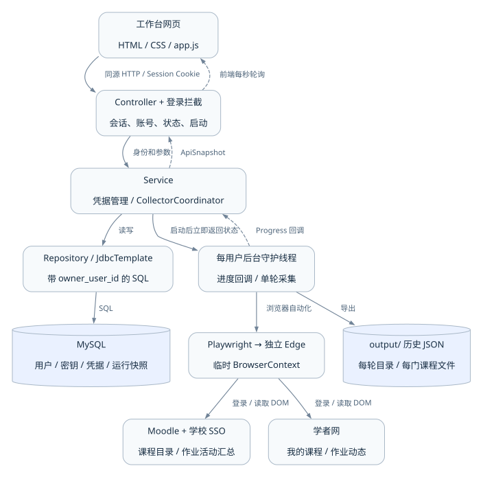

<details>
<summary>展开可编辑的 Mermaid 源码</summary>

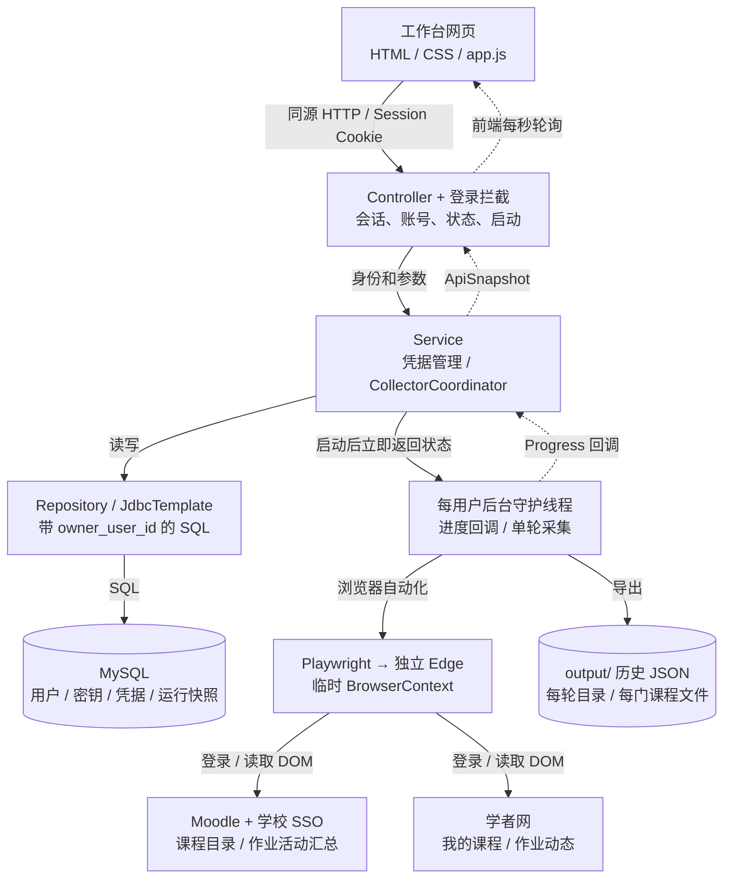

</details>


### 1.1 从学生熟悉的操作理解各层

你在网页点击“更新作业”，实际先到本机的 Spring Boot 服务。本机服务把任务交给后台线程；后台线程通过 Playwright 打开一个新的 Edge 窗口，像用户一样登录学校网站、进入课程页面、读取表格。读取后的结构化数据存到 MySQL，同时导出 JSON；工作台网页定时询问服务“现在到哪一步了、有哪些作业”，再更新页面。

| 层次 | 项目中的位置 | 具体职责 | 不承担的职责 |
| --- | --- | --- | --- |
| 展示层 | `resources/web/index.html`、`styles.css`、`app.js` | 登录表单、账号管理、请求接口、合并结果、筛选和渲染 | 不直接查询 MySQL，也不直接控制学校网站的页面 |
| HTTP 接口层 | `web/AccountController`、`SiteCredentialController`、`MoodleHomeworkWebController` | 接收请求、检查必要条件、从 Session 取当前用户、调用服务 | 不逐行解析教学平台的作业表格 |
| 业务层 | `service/SiteCredentialService`、`CollectorCoordinator` | 平台账号归属、密码加解密、启动采集、按用户保存运行状态 | 不把浏览器页面当成数据库表 |
| 数据访问层 | `repository/` | 用 `JdbcTemplate` 执行参数化 SQL，按用户读写账号和快照 | 不决定 Moodle DOM 应该怎么定位 |
| 采集层 | `collector/` | 控制 Edge、等待页面、解析课程与作业、产生进度、导出文件 | 不判断作业是否已经提交 |
| 安全与配置 | `security/`、`config/` | Session 拦截、Origin 校验、密码哈希、平台密码加密、响应头、初始化账号 | 当前没有完整的角色权限体系 |

### 1.2 为什么学校网站不能直接当成本项目数据库查

学校网站的数据和权限由对方系统管理，本项目没有学校数据库连接，也没有实现一套官方作业 API 客户端。当前实现读取的是**已登录浏览器渲染后的 DOM**。DOM 可以理解为浏览器把 HTML 组织成的元素树：标题、链接、表格行、输入框都是树中的节点。

Playwright 的 `locator(...)` 在这棵树上找元素，`fill(...)` 填表单，`click()` 点击，`innerText()` 和 `getAttribute()` 取文字与属性。项目中的 JavaScript 片段还会在浏览器页面里检查页码、加载状态等条件。

因此，这个项目准确的技术路线是：**浏览器自动化采集 + 本机 Web 工作台 + 数据快照汇总**。没有使用大模型识别页面，也没有 Redis、消息队列或分布式采集调度。

**源码入口：**[应用入口](../../src/main/java/cn/example/MoodleHomeworkApplication.java)、[协调服务](../../src/main/java/cn/example/service/CollectorCoordinator.java)、[前端脚本](../../src/main/resources/web/app.js)。

## 02 · 全链路流程：一次操作如何走完整个系统


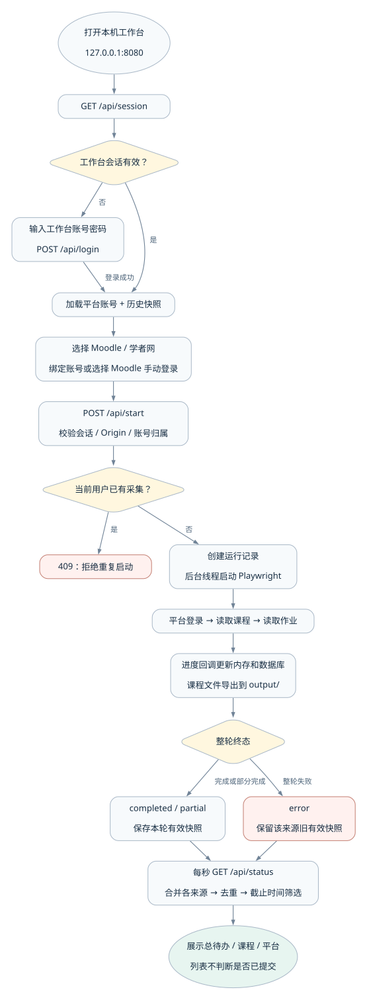

<details>
<summary>展开可编辑的 Mermaid 源码</summary>

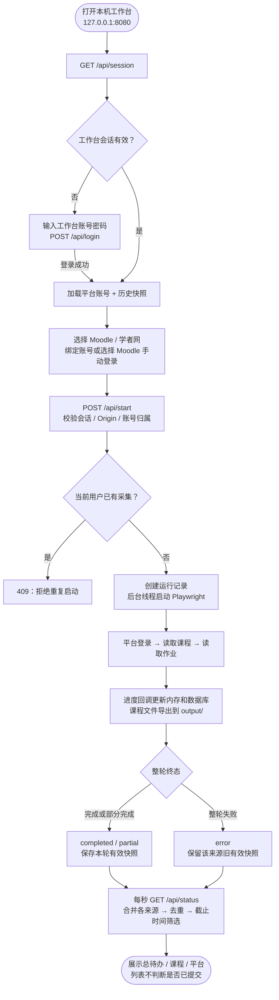

</details>


### 2.1 工作台浏览器与采集浏览器是两个角色

| 浏览器角色 | 打开的内容 | 登录身份 | 生命周期 |
| --- | --- | --- | --- |
| 工作台浏览器 | `http://127.0.0.1:8080` | 本项目 `app_user` 中的账号 | 用户可一直打开；接口依赖工作台 Session |
| 采集 Edge | Moodle、学校 SSO 或学者网 | 对应教学平台的账号 | 每轮新建 BrowserContext，采集结束关闭 |

同一台电脑、甚至同一个 Edge 程序，不代表 Cookie 自动共享。采集代码调用 `browser.newContext()` 创建独立会话，不读取日常浏览器配置目录，也没有保存、恢复 `storageState`。

所以，“我平时 Edge 已经登录学校网站，为什么采集还要登录”可以由这条边界解释：日常浏览器的登录态不在新采集 Context 中。

### 2.2 一次采集有三个不同的“完成”

1. **启动请求完成：**`POST /api/start` 完成校验，建立运行记录并启动线程后就返回。此时不代表作业已经采集完成。
2. **单门课程处理完成：**某门课程已经形成 `CourseResult`，写课程 JSON 并发布进度。整轮仍可能继续。
3. **整轮完成：**最终发布 `completed` 或 Moodle 的 `partial`，数据库才把该进度作为本轮有效结果保存。之后后台线程在 `finally` 中释放该用户的运行标记。

前端每秒看到进度变化，是因为它反复查询状态，而不是因为启动请求一直挂着等待所有课程完成。

## 03 · 程序启动与初始化

### 3.1 启动顺序

```text
run.cmd
  → 切换到项目目录，设置 UTF-8 和 Playwright 环境变量
  → mvnw.cmd 执行 Spring Boot 启动目标
  → MoodleHomeworkApplication.main
  → Spring 创建 Controller、Service、Repository 等对象并注入依赖
  → 使用本机配置建立数据库连接，执行 schema.sql 初始化所需表结构
  → ApplicationRunner 按配置补建不存在的演示账号
  → 对外提供本机 HTTP 服务和静态页面
```

这是启动过程的逻辑概览，不表示所有 Bean 的内部初始化都严格逐项串行执行。Web 容器和应用生命周期由 Spring Boot 管理。

### 3.2 依赖注入是什么

`CollectorCoordinator` 的构造方法需要 `SiteCredentialService`、`CollectionRunRepository` 和 `LegacyCollectionResultLoader`。由于这些类被标记为 `@Service`、`@Repository` 或 `@Component`，Spring 会创建它们，并把相应对象传给协调器。

可以把它理解为：**对象需要什么合作对象，就在构造方法声明；Spring 负责把它们连接起来。**这解释了为什么 Controller 可以直接调用业务服务，而没有在每个接口中反复 `new` Repository。

### 3.3 配置与持久化的先后条件

- 通用配置在 `application.yml`，默认 profile 是 `dev`；真实本机数据库连接在被忽略的 `application-dev.yml`。
- `spring.sql.init.mode=always` 使 Spring 启动时执行建表 SQL。`CREATE TABLE IF NOT EXISTS` 可以避免已有表重复创建，但不等于完整的数据库版本迁移工具。
- 数据库本身需要预先存在，账号也需要相应权限；`schema.sql` 不能在连接尚未成功时凭空创建可连接的数据源。
- `TestAccountSeeder` 只在配置允许且账号不存在时初始化 `admin`、`zhangsan`；这两个名字没有对应到不同的管理员 / 普通用户权限实现。
- 默认服务只监听 `127.0.0.1:8080`；当前配置面向本机使用。

**源码：**[启动脚本](../../run.cmd)、[通用配置](../../src/main/resources/application.yml)、[账号初始化](../../src/main/java/cn/example/config/TestAccountSeeder.java)、[表结构](../../src/main/resources/schema.sql)。

## 04 · 工作台登录、Session 与接口保护


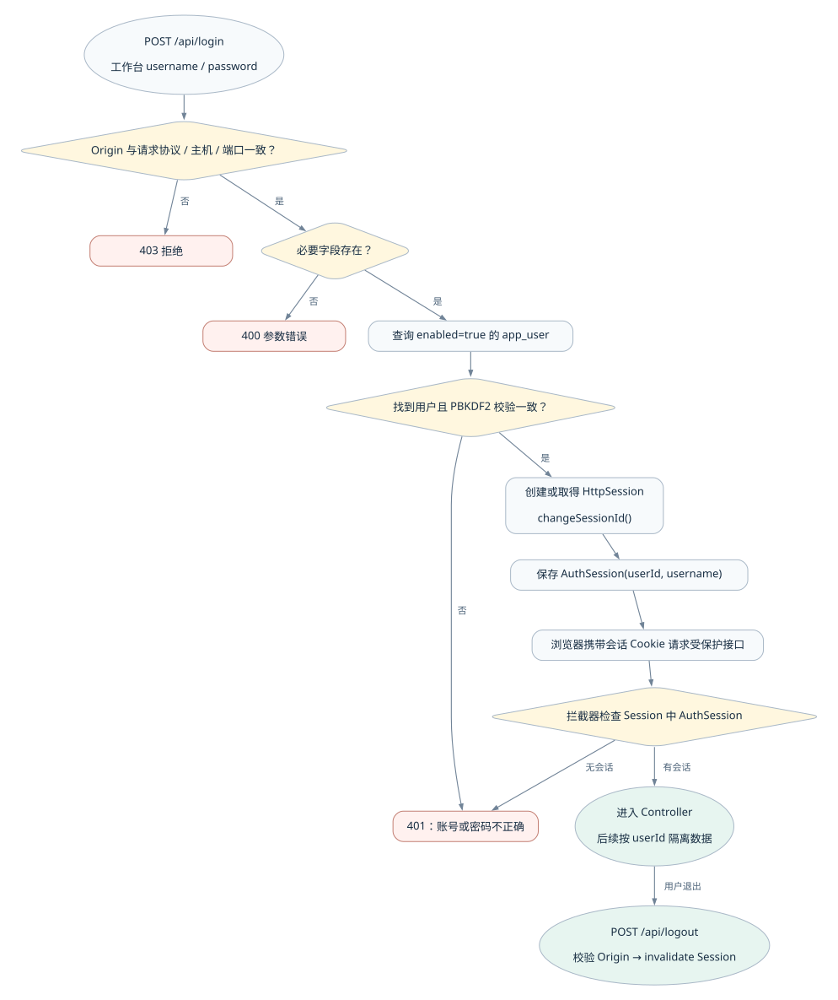

<details>
<summary>展开可编辑的 Mermaid 源码</summary>

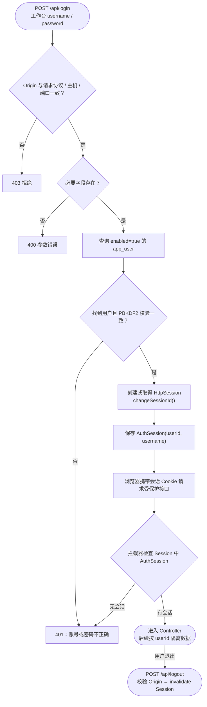

</details>


### 4.1 工作台密码为什么使用哈希

工作台只需要回答“这次输入的密码是否正确”，不需要恢复它的明文。因此，`PasswordHasher` 使用 `PBKDF2WithHmacSHA256` 派生并保存密码校验值。

新增密码的当前参数：

| 参数 | 当前值 | 作用 |
| --- | --- | --- |
| 随机盐 | 16 字节 | 即使两个人密码相同，通常也会得到不同的保存结果 |
| 迭代次数 | 210,000 | 增加每次尝试密码的计算成本 |
| 派生长度 | 256 位 | 指定输出校验值的长度 |
| 存储格式 | `pbkdf2-sha256$iterations$salt$hash` | 同时记录校验时所需的参数 |
| 比较方式 | `MessageDigest.isEqual` | 使用专门的字节校验方法比较结果 |

登录时，程序从保存字符串取出盐和迭代次数，用本次输入的密码重新派生，再与保存的校验值比较。**不是先把数据库中的哈希“解密成密码”。**

### 4.2 Session 如何记住你

登录成功后，服务器执行 `getSession(true)` 并调用 `changeSessionId()`，然后把 `AuthSession(userId, username)` 放进服务器 Session。浏览器后续向本机工作台发请求时携带会话 Cookie，服务器就能找到对应的 Session。

这里传给业务层的用户编号来自服务器保存的身份信息，而不是让前端在请求里随意提交 `ownerUserId`。

`changeSessionId()` 在登录后更新会话编号，减少登录前会话编号被利用的风险。退出登录则调用 `invalidate()` 使该 Session 失效。

当前配置中 Session 超时为 12 小时，是服务端会话超时配置；不能把它理解为应用关闭后仍保证登录有效。项目没有配置外部共享 Session 存储。

### 4.3 Session、归属校验、Origin 分别解决什么

| 校验 | 问题 | 本项目的实现 |
| --- | --- | --- |
| Session 身份校验 | 请求者有没有登录工作台？ | `LoginRequiredInterceptor` 检查 `AuthSession`，不满足返回 401 |
| 数据归属校验 | 已登录用户能否操作这个平台账号？ | 以 `owner_user_id + credentialId` 查询，找不到返回 404 |
| Origin 校验 | 修改操作是否来自本机工作台的同源页面？ | 修改接口比较协议、主机名、有效端口，不满足或缺少 Origin 返回 403 |

“同源”不是“看起来是同一台电脑”。例如 `localhost` 与 `127.0.0.1` 的主机名不同，按这段实现不能视为相同 Origin。

Cookie 配置有 `HttpOnly` 与 `SameSite=Strict`；安全响应头还设置了内容来源限制、禁止被嵌入为框架等。它们各自缩小特定风险面，不表示所有安全问题已经被解决。这里也没有引入完整的 Spring Security 登录体系，而是使用项目自己的 Controller、拦截器和校验类。

**源码：**[AccountController](../../src/main/java/cn/example/web/AccountController.java)、[PasswordHasher](../../src/main/java/cn/example/security/PasswordHasher.java)、[拦截配置](../../src/main/java/cn/example/config/WebConfiguration.java)、[SameOriginGuard](../../src/main/java/cn/example/security/SameOriginGuard.java)、[安全响应头](../../src/main/java/cn/example/security/SecurityHeadersFilter.java)。

## 05 · 平台账号绑定与密码加密


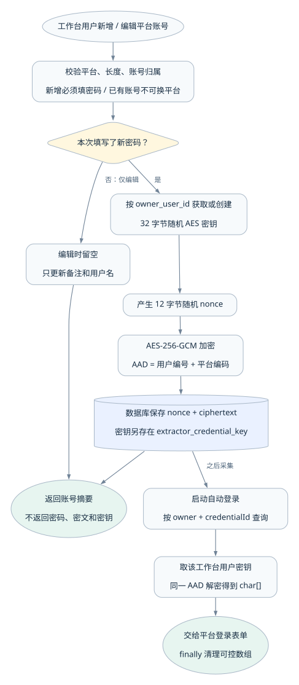

<details>
<summary>展开可编辑的 Mermaid 源码</summary>

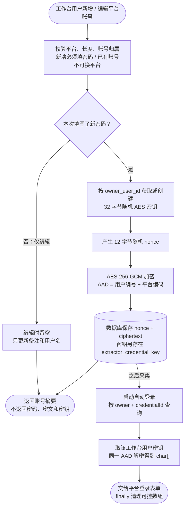

</details>


### 5.1 为什么平台密码不能也只存哈希

自动登录教学平台时，本项目必须把原密码填进对方的密码框。哈希不能用来恢复原密码，所以平台凭据使用可解密的 AES-GCM。

| 密码类型 | 实际用途 | 保存方式 | 正常业务是否需要恢复明文 |
| --- | --- | --- | --- |
| 工作台登录密码 | 证明用户身份 | PBKDF2 哈希 | 不需要 |
| Moodle / 学者网密码 | 代用户填入平台登录表单 | AES-256-GCM 密文 | 自动登录时需要 |

这里的区别来自业务需求，不是“某个算法一定比另一个高级”。

### 5.2 新增和编辑的规则

`SiteCredentialService.save` 会校验支持的平台、备注与用户名长度、密码长度和原账号归属。

- 支持的平台编码只有 `scnu-moodle` 与 `scholat`。
- 新增绑定必须填写密码。
- 编辑时密码留空，保留原来的密码密文；备注和用户名仍可更新。
- 已有绑定不能直接从 Moodle 改成学者网，需要新建绑定。
- 同一工作台用户、同一平台、同一登录用户名受数据库联合唯一约束保护；重复会返回 409。
- 保存绑定本身不代表对方平台已经确认账号密码正确；真正验证发生在随后自动登录时。

### 5.3 AES-GCM 里的 key、nonce、AAD

1. **key：**每个工作台用户拥有一份 32 字节随机密钥，即 256 位，保存在 `extractor_credential_key`。同一工作台用户的多个平台账号可共用这份用户级密钥。
2. **nonce：**每次加密生成 12 字节随机值，随密码密文保存。它不是密码，也不需要保密；GCM 对同一密钥下的 nonce 唯一性有要求，当前代码通过随机生成来降低重复概率。
3. **AAD：**代码使用 `extractor-user:<userId>:site:<siteCode>` 作为附加认证数据。它参与认证但不属于被加密的密码正文。
4. **认证标签：**使用 128 位 GCM 标签；`doFinal` 的输出包含认证所需的信息，解密时会验证匹配。

这份 AAD 把密文与用户及平台关联；把密文直接换到另一用户或另一平台，通常无法通过认证。但是 AAD 没有绑定 `credentialId` 或登录用户名，不能进一步声称它阻止同一用户同一平台内的所有凭据调换。

### 5.4 明文什么时候出现、清理能保证什么

自动采集前，服务读取密文与用户密钥，解密为 `char[]`；采集结束时 `LoginCredential.close()` 将该数组填零。加解密过程也尽量清理可控的密钥和明文字节数组。

代码在加解密和填写表单时仍会构造 Java `String`。`String` 无法像数组一样被可靠地原地清零，浏览器输入框也会接收密码。因此，准确表述是“缩短可控明文数组的存活时间”，不能保证进程内从未出现可恢复的明文。

密钥与密文都在同一个 MySQL 数据库中。这能避免直接把密码明文保存到凭据表，却不能抵御完整数据库泄露时两者同时被拿走。当前没有把密钥放到独立的密钥管理服务。

**源码：**[SiteCredentialService](../../src/main/java/cn/example/service/SiteCredentialService.java)、[CredentialPasswordCipher](../../src/main/java/cn/example/security/CredentialPasswordCipher.java)、[密钥仓库](../../src/main/java/cn/example/repository/ExtractorCredentialKeyRepository.java)。

## 06 · 启动采集：协调器、后台线程与并发


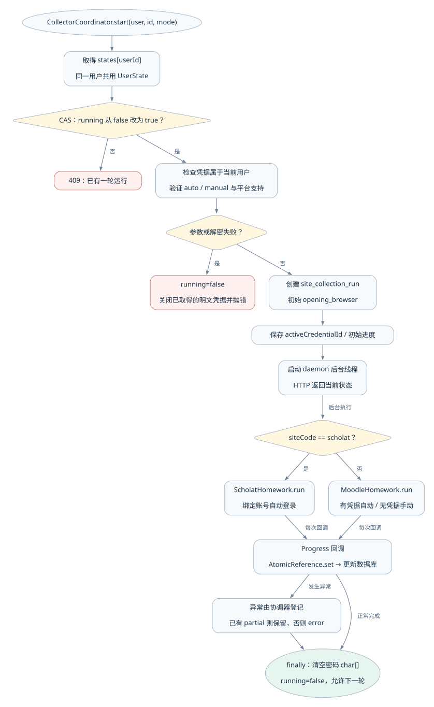

<details>
<summary>展开可编辑的 Mermaid 源码</summary>

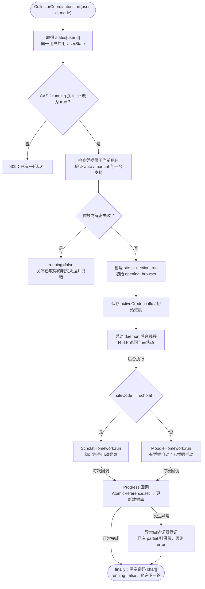

</details>


### 6.1 一份 UserState 对应一个工作台用户

协调器维护：

```text
ConcurrentHashMap<Long, UserState> states
  key   = 工作台 userId
  value = running + activeCredentialId + progress
```

`UserState` 中有三类共享状态：

| 字段 | 类型 | 为什么需要 |
| --- | --- | --- |
| `running` | `AtomicBoolean` | 防止同一工作台用户同时启动两轮采集 |
| `progress` | `AtomicReference<Progress>` | 后台更新进度，HTTP 查询线程读取最新引用 |
| `activeCredentialId` | `volatile Long` | 查询时知道正在采集哪个平台账号，并让字段更新对其他线程可见 |

`ConcurrentHashMap` 让并发访问状态表更安全；`computeIfAbsent` 让用户首次使用时建立状态。它并不自动让整个业务方法变成一个不可分割的操作。

### 6.2 CAS 为什么比先判断再赋值可靠

下面这种普通逻辑存在竞争：两个请求都先看到 `running=false`，然后各自启动一个线程。

```text
请求 A：读取 false ─────────→ 改成 true，启动任务
请求 B：      读取 false ───→ 改成 true，也启动任务
```

当前使用 `compareAndSet(false, true)`，把“检查旧值”和“写入新值”作为针对该原子变量的一次操作。两个请求竞争时，只有一个能从 false 改成 true；另一个失败并返回 409。

**作用范围是同一个 JVM 中的同一个工作台用户。**同一用户即使分别选 Moodle 与学者网，也不能并行采集；不同工作台用户则可以各自启动线程。多个服务进程不共享这张 Map，所以不能把它称为分布式锁。

### 6.3 为什么开后台线程

平台登录、页面加载、目录翻页可能耗时较长。项目使用一个 `new Thread(...)` 执行采集，让 HTTP 请求可以在启动后返回，再由状态接口反馈进度。

线程被设置为 daemon。JVM 退出时不会为这类守护线程保证继续运行，因此关闭启动窗口或进程异常结束，可能中断采集。当前实现没有线程池、全局并发配额、持久化任务队列、断点续跑和取消接口。

### 6.4 原子变量不等于整体快照原子性

`running`、`activeCredentialId`、`progress` 分别更新。它们各自具备相应的线程可见性或原子操作能力，但三者没有在同一把锁下组成统一版本的状态。状态查询在很短的时间窗口内可能观察到更新中的组合。

这个设计适合当前本机进度展示，但不能据此宣称“内存、数据库、前端始终是严格同一时刻的快照”。

**源码：**[CollectorCoordinator 的 start、runCollector、UserState](../../src/main/java/cn/example/service/CollectorCoordinator.java)。

## 07 · Moodle 登录与学校 SSO


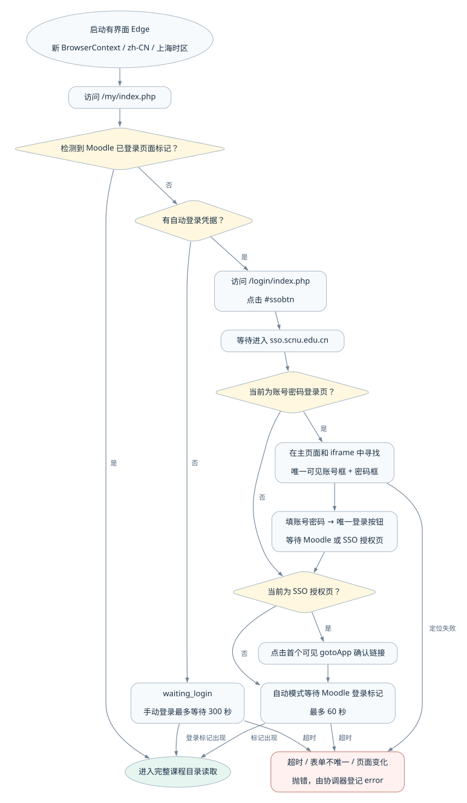

<details>
<summary>展开可编辑的 Mermaid 源码</summary>

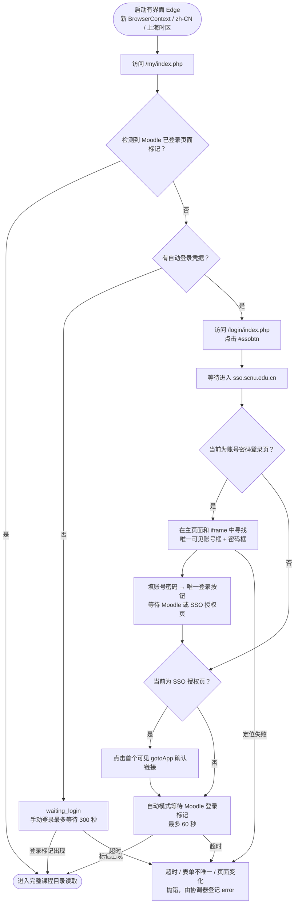

</details>


### 7.1 临时浏览器环境

`MoodleHomework.run` 用 try-with-resources 管理 Playwright、Browser 和 BrowserContext；使用已安装的 Edge 通道 `msedge`，`headless=false`，用户可以看见窗口。Context 设为中文和上海时区。默认元素操作超时为 20 秒，导航超时为 60 秒；特定登录等待另有单独时限。

try-with-resources 的作用是：无论成功还是抛异常，离开作用域都会尝试关闭这些资源。关闭过程本身也可能失败，因此不能把资源清理视为绝对不会出错的步骤。

### 7.2 如何判断 Moodle 已登录

代码寻找个人课程页的课程概览标记，或者 Moodle 首页上的用户菜单标记。公开首页本身不是登录成功证据。检测成功后，真正读取目录的逻辑仍会导航到个人课程页并验证课程区域。

这是一种**以页面业务标记验证登录状态**的方法：不只看“浏览器跳转过了”，而是看登录后应出现的结构是否存在。

### 7.3 自动登录的具体跳转

1. 进入 Moodle 登录页，点击 `#ssobtn`。
2. 等待进入 `sso.scnu.edu.cn`。
3. 若落在账号密码登录页，遍历主 frame 和各个 iframe，寻找唯一的可见账号框与密码框组合。
4. 填写绑定账号密码，定位唯一登录按钮并点击。
5. 等待跳转到 Moodle 或 SSO 授权确认页。
6. 如在授权页，点击首个可见的 `gotoApp()` 确认链接。
7. 等待 Moodle 已登录标记出现，自动模式的这一步最多等待 60 秒。

iframe 可以理解为页面内嵌的子页面。输入框若位于 iframe 内，直接在主页面查找可能找不到；代码检查各 frame 的原因就在这里。

SSO 页面可能同时渲染桌面与响应式按钮，因此“所有匹配链接只有一个”不一定成立。对授权确认链接，代码取首个可见匹配；对账号框和密码框，则要求唯一，避免填到错误位置。

### 7.4 手动登录的范围

手动模式不读取保存密码，而是等待用户在新 Edge 中完成登录，最长 300 秒。页面出现对应的登录标记后程序继续，无需回到命令窗口按回车。

验证码、WebAuthn、学校新增认证步骤并没有被本项目自动识别和解决。某些提示可以在窗口仍处于等待时人工处理；如果代码已因定位失败抛错并关闭浏览器，需要重新发起采集。

**源码：**[MoodleHomework 的 run、loginWithSavedCredential、waitForManualLogin](../../src/main/java/cn/example/collector/MoodleHomework.java)。

## 08 · Moodle 课程目录：为什么要先读全再采集


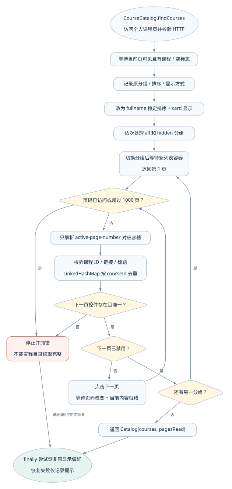

<details>
<summary>展开可编辑的 Mermaid 源码</summary>

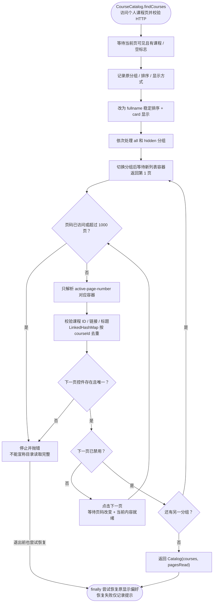

</details>


### 8.1 边读目录边进课程，为什么可能漏课

假设目录按“最近访问”排序，有两页课程。你读取第一页后马上进入其中一门课程，这次访问可能改变排序；再回目录读第二页时，课程位置已经移动，可能重复读到某门，也可能漏掉原本应该在第二页的课程。

项目采用两个措施：把目录排序切到 `fullname`，并且**先完成所有目录分页读取，再进入任何课程采集作业**。前者降低顺序变化，后者把“发现课程”和“访问课程”分开。

这是本项目针对目录页面行为的完整性策略，不代表服务器数据在采集期间完全冻结。

### 8.2 为什么读取 all 还要读取 hidden

代码注释明确说明：目标 Moodle 的 `all` 分组不包括归档课程，因此再读取 `hidden`。这里是切换概览筛选，**不等于取消归档或修改课程归档状态**。

同一门课程可能在不同读取路径出现，代码用 `LinkedHashMap<Long, Course>` 按课程 ID 去重，同时保留首次发现的顺序。

### 8.3 列表缓存与异步加载

网页可能把以前的分页内容留在 DOM 中，仅隐藏旧页。如果对整个课程区域查找卡片，可能把当前页和隐藏旧页一起读到。

当前逻辑先读取 `data-active-page-number`，再限定到对应的 `paged-content-page[data-page=...]`。切换筛选后，还会等待新的列表容器 ID；翻页后，等待页码改变，再等待目标页可见且有课程卡片或空列表标记。

这解释了为什么仅仅 `click()` 后马上取元素不够：**点击完成，不等于异步内容已经更新完成。**

### 8.4 哪些情况会拒绝返回“完整目录”

- 当前页没有课程卡片，也没有明确的空列表标记。
- 课程卡片编号和链接中的编号不一致，或链接域名、路径不符合预期。
- 课程名称为空。
- 下一页控件不是唯一一个。
- 读取到重复页码、翻页不推进、等待超时，或超过每分组的 1000 页保护上限。

这些异常会让整轮失败，因为目录都不完整时，不能把已经看到的课程包装成“全部课程”。退出时会尝试恢复原分组、排序和显示方式；恢复偏好失败只记录提示，不覆盖主要采集错误。

**源码：**[CourseCatalog 的 findCourses、changeFilter、waitForCurrentPage、readCourses](../../src/main/java/cn/example/collector/CourseCatalog.java)。

## 09 · Moodle 作业采集：空结果与读取失败


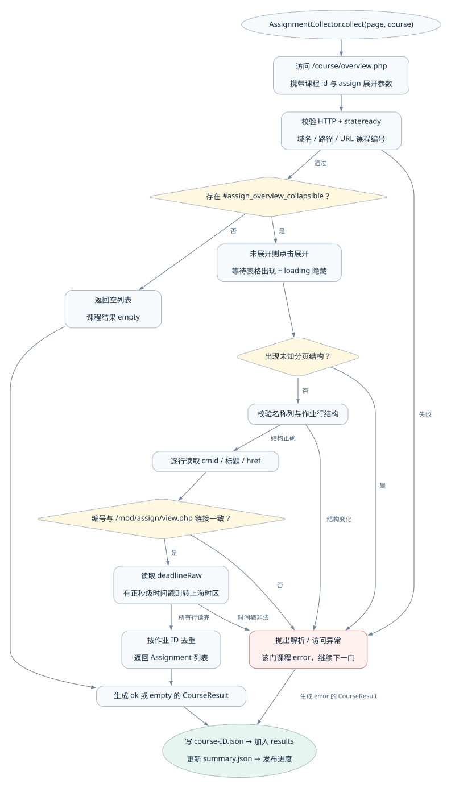

<details>
<summary>展开可编辑的 Mermaid 源码</summary>

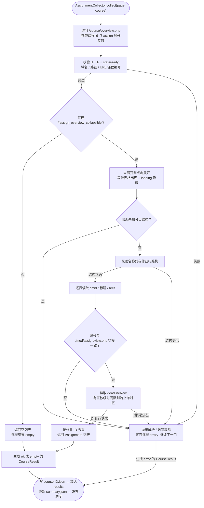

</details>


### 9.1 为什么读取活动汇总页

代码访问每门课程的 `/course/overview.php?id=...&expand[]=assign`，读取“活动 → 作业”汇总。与只读取课程首页某一章节相比，这个入口能覆盖课程汇总页提供的作业活动，减少因折叠章节而漏读的风险。

范围仍受当前平台账号权限和汇总页实际提供的内容限制，不能保证超出这些范围的数据也被读取。

### 9.2 返回空列表前先证明到了正确页面

`AssignmentCollector.collect` 先检查 HTTP 成功、目标页面就绪标记，以及当前 URL 的域名、路径和课程编号。只有确认页面仍是目标课程的活动页之后，“没有作业分组”才允许解释为没有作业。

如果登录过期后被重定向到登录页，页面上也找不到作业分组，但那是读取失败。这个前置验证可以避免把“没权限 / 未登录”误记成 `empty`。

### 9.3 展开作业分组还需要等待什么

- 分组存在但未展开：点击展开。
- 等待表格附加到 DOM。
- 等待加载图标隐藏。
- 若出现当前代码没有实现的分页结构，直接报错，避免悄悄只读取第一页。
- 校验名称列与作业行标记，再逐行读取。

每条作业需要有正的 ID、非空标题、详情链接，且链接中的 ID 与行上的 ID 一致。最后按作业 ID 去重。

### 9.4 三种课程结果必须区分

| 课程状态 | 形成条件 | `assignmentCount` | `assignments` | 含义 |
| --- | --- | --- | --- | --- |
| `ok` | 页面与结构验证通过，读到作业 | 作业数量 | 作业列表 | 读取成功且有作业 |
| `empty` | 页面与结构验证通过，明确无作业 | 0 | 空数组 | 读取成功，课程当前没有读到作业 |
| `error` | 访问、权限、页面结构或解析异常 | null | null | 不能确定这门课程有多少作业 |

`error` 的数量为 null 而不是 0，是因为“未知”与“确认为零”属于不同的信息。

### 9.5 Moodle 如何处理单门失败

每门课程的作业读取包在独立的 `try/catch(RuntimeException)` 中。出错就构造该门课程的 `error` 结果，仍然导出、加入本轮列表并处理下一门。循环结束后，只要存在失败课程，整轮就发布 `partial`，否则 `completed`。

发布 `partial` 后代码还会抛异常，协调器识别到上一进度已是 `partial`，会保留它。这个异常不应被文档简单画成“所有异常最终都变成 error”。

当前判断只检查失败课程数量是否大于零：**即使每门课程都失败，只要目录读取和输出流程走完，也可能得到名为 partial 的整轮结果。**不能据状态名称推断一定有某门成功。

**源码：**[AssignmentCollector](../../src/main/java/cn/example/collector/AssignmentCollector.java)、[MoodleHomework 的课程循环与最终状态](../../src/main/java/cn/example/collector/MoodleHomework.java)。

## 10 · 学者网流程：新标签页、标题配对与日期


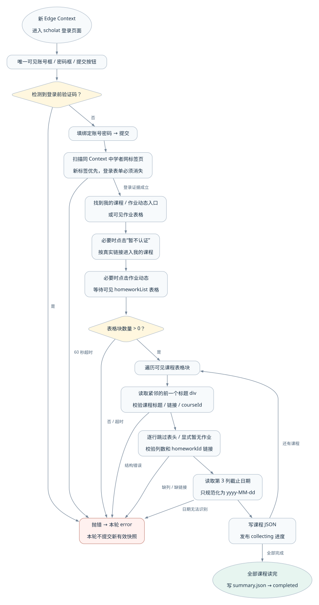

<details>
<summary>展开可编辑的 Mermaid 源码</summary>

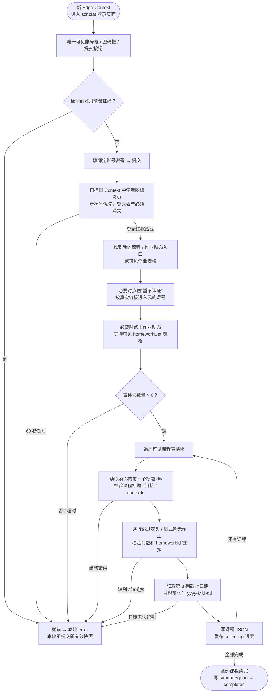

</details>


### 10.1 支持范围与 Moodle 不同

学者网当前只支持已绑定账号的自动登录。采集范围是**“我的课程 → 作业动态”中实际找到的可见课程作业表格**；代码没有实现与 Moodle 相同的“all + hidden 全目录分页”过程，也没有读取“更多”页面的额外分页。

所以，文档不能把两个平台一律描述成“已穷尽该账号所有课程与历史作业”。

### 10.2 登录后为什么要扫描标签页

学者网的入口可能打开新标签页，也可能落到不同首页。`waitForSitePage` 扫描同一个 Context 的所有页面，优先检查最新的标签页，仅接受 HTTPS 的学者网域名。

登录证据是“我的课程入口”“作业动态入口”或可见课程作业表格，同时不能仍显示登录表单。旧主页还留着某些入口时，新标签优先可以减少一直等待错误页面的情况。

页面有“暂不认证”时，代码会尝试点击该网站提供的可选按钮。进入我的课程时使用实际链接并校验目标域名与路径，再在同一登录会话导航。

### 10.3 验证码分支要按代码理解

提交登录前，代码若检测到可见验证码元素，会直接抛异常；不会停在这个分支持续等待用户解完验证码。外层 try-with-resources 随后会关闭该轮浏览器资源。因此，不能把提示文字“请手动完成后再继续”理解成已经实现了可恢复的人机验证流程。

提交后的提示或作业动态入口被遮挡时，等待循环在限定时间内可以允许人工关闭提示后继续。**这与登录前验证码直接抛错是两个不同分支。**

### 10.4 标题与表格为什么要严格配对

目标页面中的课程标题 div 和课程表格 div 是相邻的兄弟节点，而非放在一个共同的“课程卡片容器”里。代码从每个作业表格块向前找**紧邻的标题 div**，然后提取课程链接和名称。

如果标题区域不存在、缺少课程链接或缺少带 `courseId` 的链接，会报错。它没有从更前面的其他课程标题里随便找一个来凑，这能避免把甲课程的作业标到乙课程名下。

### 10.5 表格行的读取

1. 只处理可见作业动态下的课程表格块。
2. 跳过显式“暂无作业”行。
3. 跳过使用 `td` 渲染、首列为“作业名称”且没有作业链接的表头行。
4. 其他行要求至少 5 列，并在第一列找到带 `homeworkId` 的作业链接。
5. 取 title 属性，缺少时取链接文本。
6. 读取第 3 列截止日期；空、“无”“未设置”保留为空标准化值，其余必须能解析成 `LocalDate`。

学者网当前没有像 Moodle 一样在采集层按作业 ID 去重；前端展开总待办时仍会使用复合键去重。这两个层次不要混为一谈。

### 10.6 学者网单课程失败会终止本轮

`readCourse` 的 RuntimeException 被包装后重新抛出，循环不会继续，也不会为这门课程构造 `error` 结果后发布 `partial`。因此正常整轮输出为 `completed`，失败由协调器记为 `error`。

失败之前已经导出的课程文件和进度可能存在，但不会因为“已经读了几门”就自动成为本轮有效 `result_json`。测试看板可以展示带 `partial` 的模拟学者网数据，也不代表真实学者网采集器已经实现这种终态。

**源码：**[ScholatLogin](../../src/main/java/cn/example/collector/ScholatLogin.java)、[ScholatHomework](../../src/main/java/cn/example/collector/ScholatHomework.java)。

## 11 · 进度状态机：状态、运行标记与百分比


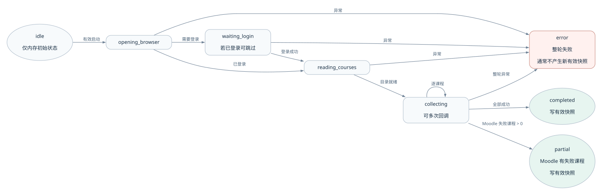

<details>
<summary>展开可编辑的 Mermaid 源码</summary>

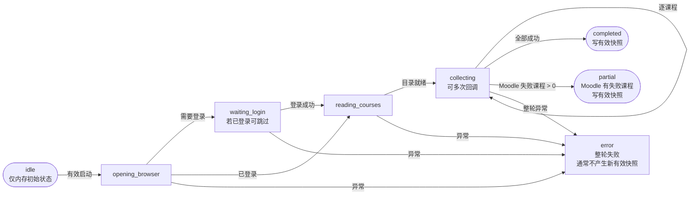

</details>


### 11.1 Progress 的字段

| 字段 | 意义 |
| --- | --- |
| `stage` | 当前阶段或终态 |
| `message` | 给用户的进度描述 |
| `catalogPagesRead` | 已读目录页数；学者网当前进度构造器固定填 1，不能据此推断其遍历过全部分页 |
| `totalCourses` | 本轮发现的课程总数 |
| `processedCourses` | 已形成结果的课程数量；不是作业条数 |
| `assignmentCount` | 本轮已读取、可计数的作业总量 |
| `currentCourse` | 当前处理的课程名 |
| `outputDirectory` | 本轮导出的绝对目录；前端当前不直接展示该路径文本 |
| `courses` | 本轮已产生的课程结果列表 |

回调构造列表时使用 `List.copyOf`，避免把不断追加的原始列表直接作为一个共享的可变列表暴露出去；这不等于把整套内存与数据库更新变成事务。

### 11.2 stage 与 running 是两个字段

`stage` 描述采集进度；`running` 描述协调器是否仍占用该用户的采集槽。最终进度发布后，后台线程还要完成资源关闭、凭据清理等操作，所以可能短暂看到 `stage=completed` 且 `running=true`。

进度图是正常阶段的逻辑关系；启动参数失败可能在浏览器阶段之前就返回错误。某些资源清理或持久化异常，也可能在已发布终态之后再触发协调器的错误处理。

### 11.3 进度百分比是界面估算

前端 `progressPercent` 的规则：

| 阶段 | 当前计算方式 |
| --- | --- |
| `opening_browser` | 8% |
| `waiting_login` | 14% |
| `reading_courses` | 24% |
| `collecting` | `min(96, 25 + round(processedCourses × 70 / totalCourses))`，前提是课程数大于 0 |
| `completed` | 100% |
| `partial` / `error` | 有课程时 `min(98, round(processedCourses × 100 / totalCourses))`，否则 0 |

这是阶段权重加课程完成比例，用来让页面反馈更连贯。它不是根据每门课程真实耗时训练出来的进度，也不能用来准确预测剩余秒数。

**源码：**[Progress 定义](../../src/main/java/cn/example/collector/MoodleHomework.java)、[前端 progressPercent](../../src/main/resources/web/app.js)。

## 12 · 数据保存：运行记录、有效快照与 JSON 文件


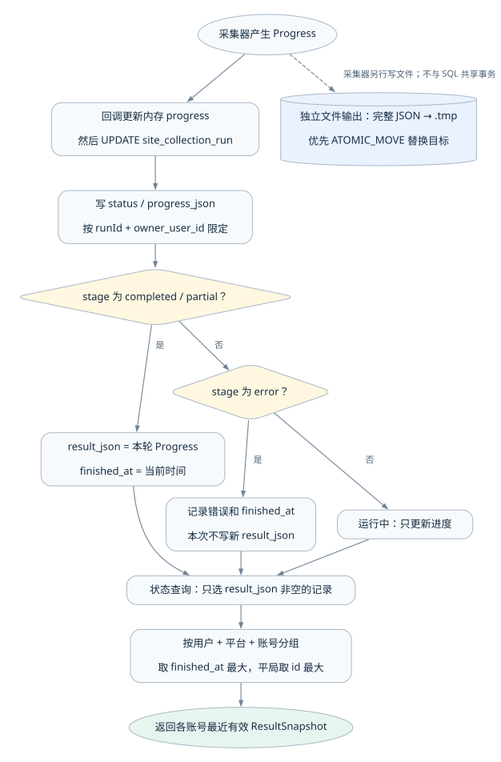

<details>
<summary>展开可编辑的 Mermaid 源码</summary>

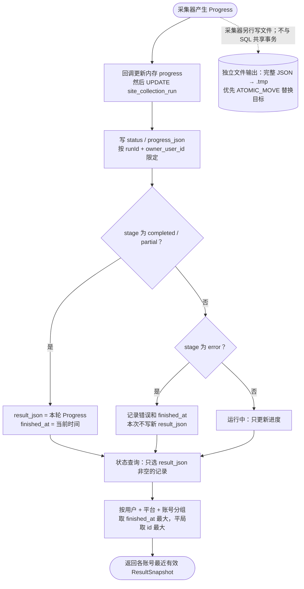

</details>


### 12.1 progress_json 与 result_json 为什么分开

| 保存内容 | 什么时候更新 | 用途 |
| --- | --- | --- |
| 内存 `UserState.progress` | 每次进度回调先更新 | 当前进度展示 |
| `progress_json` | 每次进度回调 | 保存这一轮最新进度，包括运行中或错误 |
| `result_json` | 发布 `completed` 或 `partial` 时 | 作为看板可以选择的本轮有效结果 |
| `status` | 每次进度回调 | 对应当前进度阶段 |
| `finished_at` | 终态 `completed`、`partial`、`error` | 记录结束时间，用于结果排序 |
| `error_message` | `partial` 或 `error` | 保存相关消息 |

一轮运行中途已经读到数据，并不代表 `result_json` 已经可用。新一轮普通失败通常没有有效结果，于是看板还可以取该来源之前的有效快照。

### 12.2 “失败不覆盖旧结果”的真实机制

假设同一账号先后有：

| 运行 | 结束状态 | result_json | 结果查询是否可选 |
| --- | --- | --- | --- |
| R1 | completed | 有 | 可选 |
| R2 | error，且此前未成功保存终态结果 | 空 | 不可选 |
| R3 | partial | 有 | 可选，且比 R1 更新 |

查询不是把 R2 删除，而是只考虑 `result_json IS NOT NULL` 的记录；再从同一用户、平台和绑定账号这一组中选择最新。因此 R2 留在运行历史中，但不会把 R1 的待办清空；R3 则成为新的来源快照。

`updateProgress` 使用 `result_json = COALESCE(?, result_json)`。当传入 null 时保留**该运行行已有的**结果，而不是跨运行复制旧结果。跨运行保留展示的效果来自后续查询。

还存在一个细节：如果一轮已保存 completed / partial 的 `result_json`，之后资源清理等步骤再抛异常，该行可能变成 `status=error` 而结果仍非空。查询按非空结果筛选，没有再要求 status 必须是 completed / partial。文中“失败保留旧结果”描述的是通常路径，不能把它当成所有异常时间点的绝对保证。

### 12.3 每个来源如何取最新

来源分组由以下部分组成：

```text
工作台 owner_user_id + 平台 site_code + 平台凭据 site_credential_id
```

未绑定账号的手动结果用 `site_credential_id IS NULL` 单独分组。多个未绑定手动登录的 Moodle 账号不会各自拥有稳定凭据编号，因而它们共享这个“未绑定手动来源”的最新结果槽；想长期区分不同学校账号，应分别绑定。

`findLatestResults` 使用 `NOT EXISTS`：如果存在同组、更晚 `finished_at` 的非空结果，当前行就不是最新；结束时间相同时，用更大的运行 ID 决胜。它返回每组一份，并排除已无对应绑定账号的非空凭据来源。

### 12.4 0 门课程与失败完全不同

如果 Moodle 目录确认为空，仍可以完成并保存 `courses=[]` 的有效快照，它会替换该来源之前有课程的快照。若目录读取失败，则不能用空数组冒充成功结果。

学者网当前“0 个可见课程表格块”被视为错误，没有采用同样的“零课程成功”分支。

### 12.5 文件输出与原子替换

```text
output/
  user-<工作台ID>-platform-account-<凭据ID>/
    run-<yyyyMMdd-HHmmss-SSS>/
      course-<课程ID>.json
      summary.json

  user-<工作台ID>-manual/
    run-<时间>/...
```

`writeJson` 先把完整 UTF-8 JSON 写到同目录临时文件，再优先用 `ATOMIC_MOVE + REPLACE_EXISTING` 替换目标；文件系统不支持原子移动时退回普通替换。它降低读到半份 JSON 的风险，但不能保证进程崩溃时文件和数据库同步完成，也不等于整轮所有课程文件组成一个事务。

Moodle 每门课程后更新包含课程文件索引的 `Summary`；学者网完成后写入的是 `Progress` 结构的 summary。两者文件名相同，内部结构并不完全一致。旧版加载器读取的是 Moodle 的 `Summary` 格式，不能直接视为通用跨平台导入器。

### 12.6 内存、数据库、文件之间没有共同事务

进度回调先更新内存，再执行 SQL；课程文件也在采集流程的其他位置写入。代码没有跨这些位置的统一事务与补偿。某次 SQL 或文件写入失败，可能留下“内存已经前进、数据库未前进”或“文件存在、数据库无最终快照”的状态。

这属于当前持久化边界，不能把“双份保存”理解成自动互相修复的备份系统。

**源码：**[CollectionRunRepository](../../src/main/java/cn/example/repository/CollectionRunRepository.java)、[MoodleHomework.writeJson / writeSummary](../../src/main/java/cn/example/collector/MoodleHomework.java)、[ScholatHomework.run](../../src/main/java/cn/example/collector/ScholatHomework.java)。

## 13 · 看板如何汇总多个账号的作业


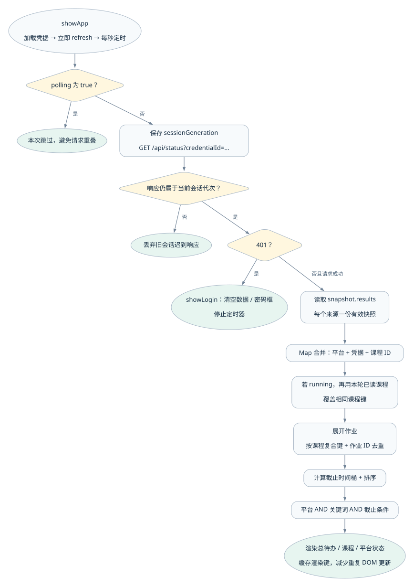

<details>
<summary>展开可编辑的 Mermaid 源码</summary>

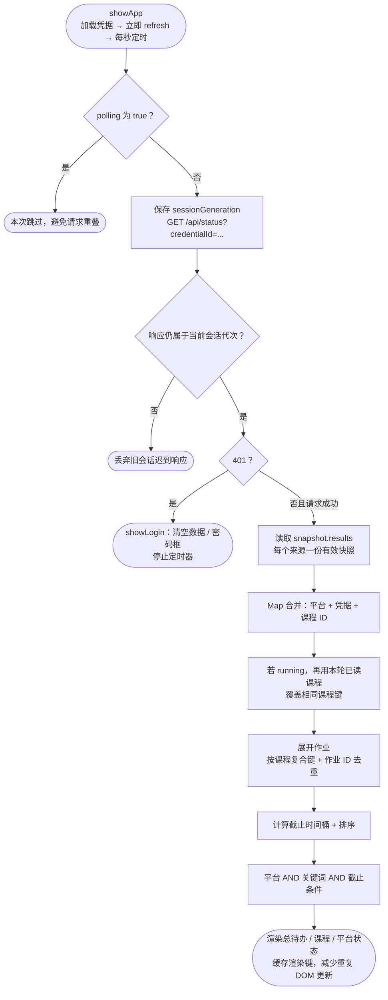

</details>


### 13.1 轮询的工作方式

`showApp` 加载平台账号，先请求一次状态，再设置每 1000 毫秒调用 `refresh`。`polling` 标记避免前一个状态请求没结束时又叠加一个。

这是浏览器主动发起的**定时 HTTP 轮询**，没有 WebSocket 或 SSE。定时器每秒触发也不等于数据每秒必定更新：网络、请求耗时、浏览器节流以及前一次请求仍在运行都会影响实际频率。

`refresh` 携带选中的 `credentialId`，主要影响 `latestResult` 这一所选来源结果；后端同时返回 `results`，供总待办汇总当前用户的所有来源。不能把选择采集账号误解为总待办只展示那个账号。

### 13.2 合并课程的复合键

`combineCourses` 的键是：

```text
[siteCode, credentialId 或 manual, courseId 或 courseUrl]
```

假设 Moodle 账号 A 和学者网账号 B 都有 `courseId=101`，只按 101 去重会丢掉其中一门。即使同一平台，两个绑定账号下的相同课程编号也仍被保留为各自的数据来源。

这里的“去重”是**避免同一来源的同一对象重复展示**，不是识别两个平台上名字相似的作业是否属于同一份任务。项目没有实现跨平台语义去重。

### 13.3 采集中如何覆盖旧课程

先把全部来源的旧有效快照放进 Map；若 `snapshot.running=true`，再把本轮已形成结果的课程放入同一 Map，使用相同课程键覆盖旧课程。

例如旧快照有 A、B、C 三门课程：本轮暂时只读完 A，页面显示“新 A + 旧 B + 旧 C”。这可以在采集期间持续展示尚未重读的旧数据。

但是**覆盖单位是整门课程**。如果本轮 A 形成的是 `error` 结果，它也会覆盖旧 A 的课程对象，而不是自动保留旧 A 的作业列表。后台结束后只依据最终快照汇总；若是 partial，该来源旧快照不会逐门继续混入。

若整轮学者网采集失败且没有新有效快照，`running=false` 后不再叠加本轮中间数据，通常重新呈现旧有效快照。

### 13.4 作业展开、去重、排序和筛选

`allAssignments` 展开每门课程的作业，使用“课程复合键 + 作业 ID，缺失时取 URL 或标题”去重。按可解析截止值升序排序，缺失时间按 Infinity 放后面，再按中文标题比较打破平局。

总待办的筛选是三个条件同时满足：

```text
平台匹配 AND 截止时间条件匹配 AND 关键词匹配
```

关键词会搜索作业标题、课程名、账号备注和平台名。切换筛选仅操作前端已有数据，不会触发学校网站重新采集。

### 13.5 为什么退出后旧响应不能把数据填回来

用户退出时，`showLogin` 增加 `sessionGeneration`、清空账号与课程数据、清空相关密码框、停止定时器。每次异步读取会保存发起时的 generation；返回时若代次不同，就丢弃响应。

它解决的是前端异步请求的先后竞争：例如退出登录后，之前慢速返回的旧用户状态不应该重新出现在页面。

这不是后端停止采集。退出接口只失效 Session，没有给已启动后台线程发送取消信号。

### 13.6 展示文本与链接的处理

前端用 `textContent` 填写提取来的标题等文本，避免直接把它们拼成 HTML 执行。作业链接只有 `http:`、`https:` 会被生成为可点击链接，并设置新标签和 `noopener noreferrer`；其余 URL 作为普通文字展示。

渲染函数用 JSON 构造的缓存键跳过未变化内容，减少频繁重新构建 DOM。仍然需要先获取、解析状态数据，这不等于后端只传增量数据。

**源码：**[app.js 的 showApp、refresh、combineCourses、allAssignments、renderTodo、showLogin](../../src/main/resources/web/app.js)。

## 14 · 截止时间：精确时刻与日历日期


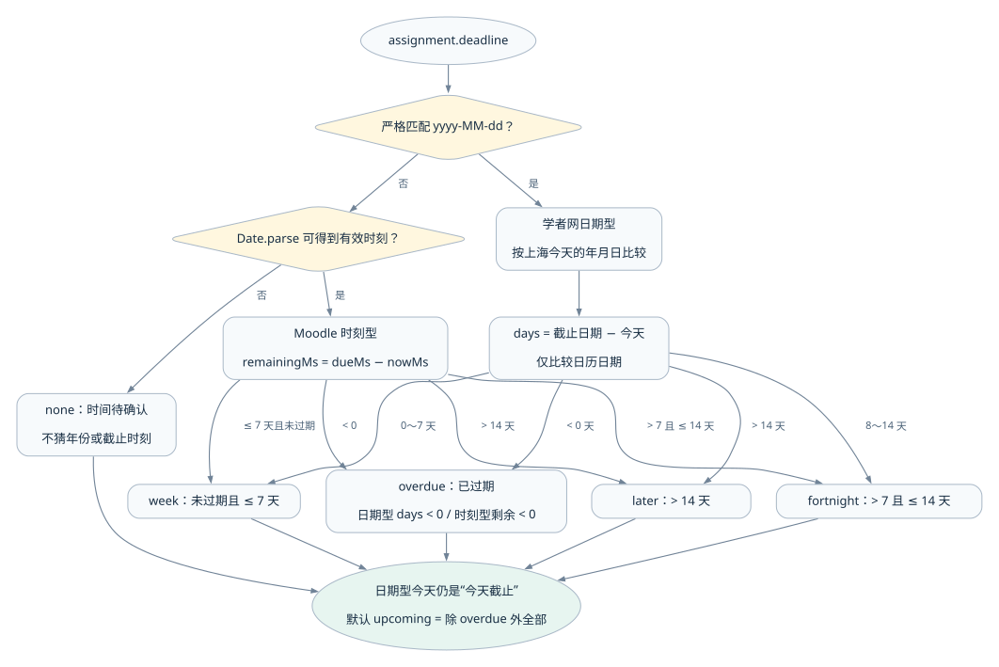

<details>
<summary>展开可编辑的 Mermaid 源码</summary>

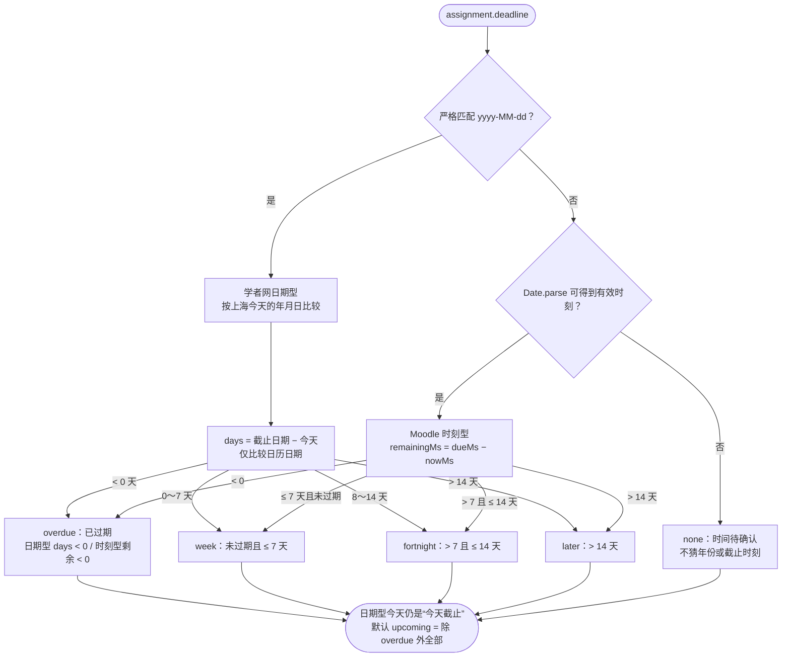

</details>


### 14.1 Moodle 读取服务器时间戳

作业表格可提供 `data-mdl-overview-value` 秒级 Unix 时间戳。代码通过 `Instant.ofEpochSecond`，转为 `Asia/Shanghai`，再输出带偏移量的 ISO 时间字符串，例如 `2026-10-28T23:59:00+08:00`。

原页面文字单独保存在 `deadlineRaw`。页面文字可能省略年份，因此不靠它猜年份；没有可靠时间戳时，标准化截止时间保持 null。负数或无法解析的非零时间戳会触发错误，不能默默改成一个猜测日期。

### 14.2 学者网只有日期时保留日期

学者网当前读取的字段是 `yyyy-MM-dd` 日历日期，例如 `2026-10-28`。它没有提供给本实现一个可靠的小时分钟，所以标准化结果仍然是日期，不能擅自补成当天 23:59。

前端识别这种格式，取上海“今天”的年月日，构造日历差：

```text
days =（截止日期的日历坐标 − 上海今天的日历坐标）/ 一天
```

代码用 `Date.UTC` 为两个日期生成可相减的数值，这里用途是做日历运算，**不是宣称学校截止时刻就在 UTC 零点**。

### 14.3 分类规则

| 分类 | 精确时刻 | 日期型 |
| --- | --- | --- |
| `overdue` | 截止时刻早于当前时刻 | 截止日期早于上海今天 |
| `week` | 未过期且 7×24 小时内，含边界 | 今天至 7 天后，含边界 |
| `fortnight` | 超过 7×24 小时，且 14×24 小时内 | 8 至 14 天后 |
| `later` | 超过 14×24 小时 | 超过 14 天 |
| `none` | 缺失或不能解析 | 无可用日期 |

日期型作业在截止当天显示“今天截止”，不能据此精确判断当天几点过期。默认 `upcoming` 筛选的实际代码是“排除 overdue”，所以**没有截止时间的作业也会保留**，显示时间待确认。

### 14.4 示例：同一天也可能呈现不同状态

假设当前是上海时间 2026-10-26 18:00：

- Moodle 截止 `2026-10-26T17:00:00+08:00`：已经过期。
- 学者网截止 `2026-10-26`：今天截止，不补造具体时刻。
- 截止 null：时间待确认，默认未过期列表仍会显示。

后端 `ApiSnapshot` 当前没有 `now` 字段。前端虽然兼容 `snapshot.now`，但真实接口通常使用 `Date.now()`，因此本机时钟错误也会影响分类。带 `now` 的测试夹具只是为了固定测试时间。

总待办排序对日期型和时刻型使用各自计算的数值，并没有恢复未知的日期型真实截止时刻；混合排序应理解为便于查看的顺序。

**源码：**[AssignmentCollector 的截止时间读取](../../src/main/java/cn/example/collector/AssignmentCollector.java)、[ScholatHomework.readCourse](../../src/main/java/cn/example/collector/ScholatHomework.java)、[app.js 的 deadlineInfo / formatDeadline](../../src/main/resources/web/app.js)。

## 15 · 失败处理：失败发生的位置决定结果


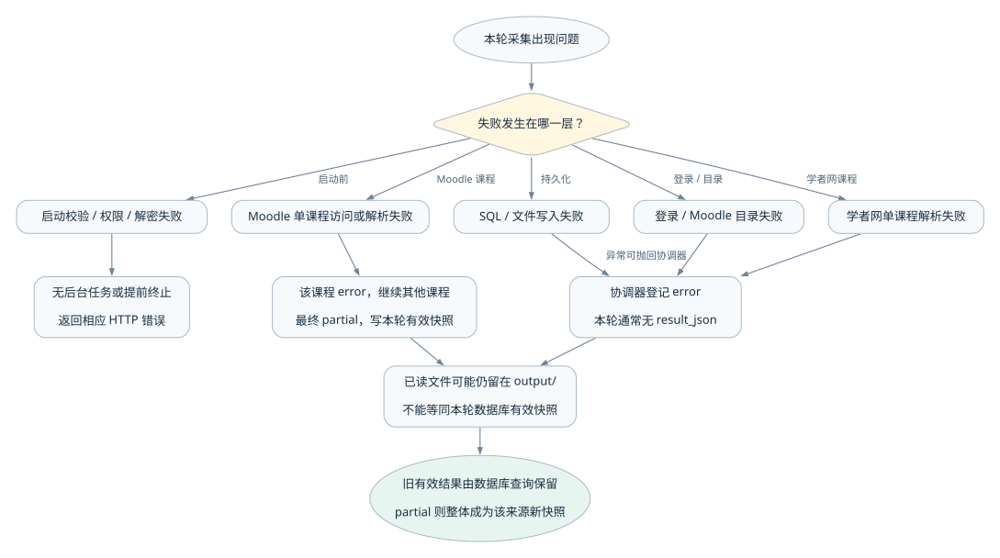

<details>
<summary>展开可编辑的 Mermaid 源码</summary>

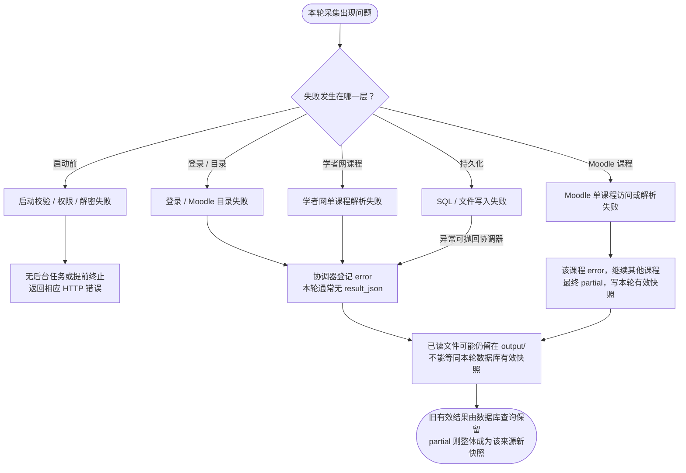

</details>


| 失败场景 | 当前处理 | 是否继续其他课程 | 对看板有效结果的通常影响 |
| --- | --- | --- | --- |
| 未登录工作台 | 401 | 未启动 | 无新结果 |
| Origin 不匹配或缺失 | 403 | 未启动 | 无新结果 |
| 非本用户的凭据编号 | 查询不到，404 | 未启动 | 无新结果 |
| 同一用户重复启动 | 409 | 已有任务照常运行 | 不新增第二轮 |
| mode / 平台组合不支持 | 400 | 未启动 | 无新结果 |
| 平台密码错误或登录超时 | 协调器记录 error | 否 | 通常仍选旧有效快照 |
| Moodle 课程目录不完整 | 整轮 error | 否 | 不能把已发现课程当完整目录 |
| Moodle 单门作业读取失败 | 单门 error，整轮最终 partial | 是 | partial 成为该来源新快照 |
| 学者网单门解析失败 | 抛出，整轮 error | 否 | 已读文件可能留存，通常仍选旧有效快照 |
| 文件写入失败 | 异常退出到协调器 | 通常否 | 数据库 / 文件可能只完成一部分 |
| 进度 SQL 更新失败 | 异常退出并尝试登记失败 | 通常否 | 可能出现内存和数据库不一致 |
| 服务进程直接退出 | 守护线程被中断 | 否 | 旧快照仍在数据库，运行中行可能未结束 |

### 15.1 “partial 保留其他课程”究竟保留哪些

保留的是**本轮其他课程的读取结果**。如果旧快照里失败课程原本有 10 个作业，本轮 partial 中该课程为 error、作业列表为 null，新 partial 被选中后不会自动再借用那 10 条旧作业。

此外，失败课程都存在时也可能形成 partial，因此页面显示“部分完成”还应结合失败课程数量判断，不能只看名称。

### 15.2 重试与恢复的当前边界

当前没有自动重试整轮、定时自动采集、任务取消、任务队列和断点续采。用户可以重新点击发起新一轮；那是创建新的运行记录，不是从上次失败课程继续执行。

服务重启后 `states` Map 重新创建，内存进度回到 idle；数据库旧有效快照仍可查询。原来处于 collecting 的数据库运行记录没有启动恢复扫描自动标记失败，因此持久化的“未终止运行”与当前内存 `running=false` 可能并存。

### 15.3 错误消息的处理

协调器使用 `safeMessage` 把异常消息截断到限定长度，保存到进度并输出日志。这有利于避免过长提示，但不是完整的敏感信息脱敏系统，也没有在此实现分级审计日志。

## 16 · 数据模型：四张关系表与 JSON 内嵌对象


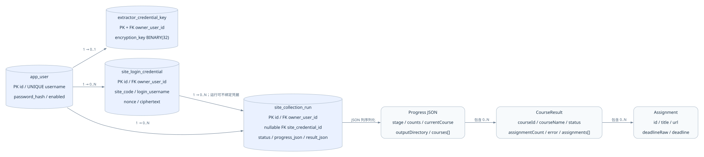

<details>
<summary>展开可编辑的 Mermaid 源码</summary>

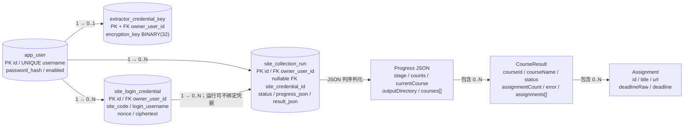

</details>


### 16.1 四张关系表

| 表 | 主键与关键字段 | 约束 | 与业务的关系 |
| --- | --- | --- | --- |
| `app_user` | `id`、`username`、`password_hash`、`enabled` | username 唯一 | 本机工作台身份 |
| `extractor_credential_key` | `owner_user_id`、`encryption_key` | owner 同时是主键和外键 | 一个用户至多一份当前平台密码加密密钥 |
| `site_login_credential` | `id`、owner、site、login_username、nonce、ciphertext | owner + site + login_username 联合唯一 | 用户绑定的平台账号 |
| `site_collection_run` | `id`、owner、可空 credential、mode、status、时间、两个 JSON 字段 | 引用用户和可选平台凭据 | 每一轮采集及其结果 |

### 16.2 不存在独立的 course、assignment 关系表

当前课程和作业作为 `Progress` 中的嵌套 JSON 保存；数据库中的字段类型是 `LONGTEXT`，不是依赖数据库 JSON 类型来做结构约束。

```text
site_collection_run.result_json
  └─ Progress
      └─ courses[]
          └─ CourseResult
              └─ assignments[]
                  └─ Assignment
```

如果只画“用户 → 课程表 → 作业表”，会把项目并不存在的关系表结构画出来。图中后半段的箭头表示 JSON 包含关系，与数据库外键不同。

### 16.3 为什么用快照式 JSON

一次采集天然得到一组课程和作业，序列化整组结构便于直接恢复看板。代价是数据库不便直接按单条作业筛选、建立约束或统计；当前筛选主要在前端进行。

这不是数据库无法保存作业表，而是当前实现选择以运行快照为主要存储单位。

### 16.4 外键与级联删除

- 删除工作台用户时，相关密钥、凭据和运行记录通过外键级联删除。
- 删除平台凭据时，引用该凭据的运行记录也会级联删除，而不只是隐藏账号备注。
- 删除凭据不会自动删除 `output/` 的 JSON 历史文件；当前服务没有对应文件清理逻辑。
- 未绑定手动运行的 `site_credential_id` 为 null，不受某个凭据删除直接关联。

这些是 SQL 所定义的关系；当前项目并没有提供删除工作台用户的普通页面接口。

**源码：**[schema.sql](../../src/main/resources/schema.sql)、[SiteCredentialRepository](../../src/main/java/cn/example/repository/SiteCredentialRepository.java)、[CollectionRunRepository](../../src/main/java/cn/example/repository/CollectionRunRepository.java)。

## 17 · 旧版本地结果的导入


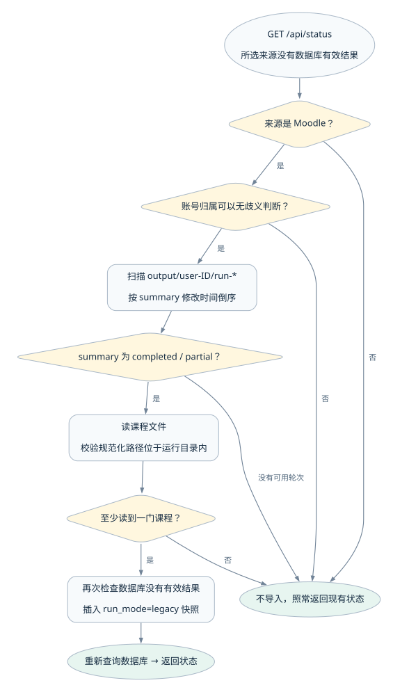

<details>
<summary>展开可编辑的 Mermaid 源码</summary>

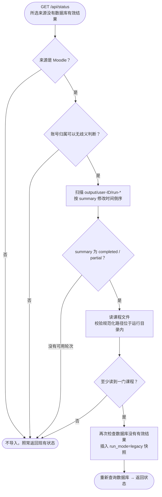

</details>


### 17.1 为什么不能把找到的文件一律导入

历史文件使用 `output/user-<工作台ID>/run-*` 目录，旧格式可能没有当前平台凭据编号。若一个工作台用户绑了多个 Moodle 账号，程序无法仅凭这个目录可靠判断文件属于哪一个学校账号。

所以导入只在以下条件尝试：

1. 当前所选来源没有数据库有效结果。
2. 来源为 Moodle。
3. 未绑定手动来源下，没有同平台绑定账号；或者所选绑定账号是该用户唯一的 Moodle 绑定账号。

这个策略追求避免错误归属，宁可不导入，也不把不确定文件归给另一个学校账号。

### 17.2 文件读取与路径检查

加载器遍历 `run-*` 目录，按 summary 的修改时间从新到旧查找。只接受 `completed` 或 `partial` 的 Moodle Summary，读取课程索引指向的文件前，先规范化路径并确认仍位于该轮目录内部。

路径检查的意义是避免 summary 中的文件名通过 `../` 等方式跳出预期目录。它不是对任意内容都进行可信认证。

当前加载器要求最终至少读到一门课程，旧版“零课程的成功结果”不会被导入。部分缺失的课程文件会被跳过，因此导入不是对旧文件集合完整性的一次严格重建。

导入数据库时 `run_mode=legacy`；有异常时协调器记录提示并继续返回状态。仓库方法的 `synchronized` 仅在当前对象实例内提供互斥，不是跨多个应用实例的数据库唯一性保证。

**源码：**[CollectorCoordinator.importLegacyResultIfUnambiguous](../../src/main/java/cn/example/service/CollectorCoordinator.java)、[LegacyCollectionResultLoader](../../src/main/java/cn/example/collector/LegacyCollectionResultLoader.java)。

## 18 · HTTP 接口与调用关系

| 方法与路径 | 是否要求工作台登录 | 是否校验 Origin | 作用 |
| --- | --- | --- | --- |
| `GET /api/session` | 否 | 否 | 查询当前会话是否已登录及用户名 |
| `POST /api/login` | 否 | 是 | 校验工作台密码，建立会话 |
| `POST /api/logout` | 是 | 是 | 失效工作台 Session |
| `GET /api/credentials` | 是 | 否 | 返回当前用户的平台账号摘要 |
| `POST /api/credentials` | 是 | 是 | 根据请求是否有 id 新增或编辑绑定 |
| `DELETE /api/credentials/{id}` | 是 | 是 | 删除本用户的绑定账号 |
| `GET /api/status?credentialId=...` | 是 | 否 | 查询内存进度、所选来源和全部来源的有效结果 |
| `POST /api/start?mode=auto&credentialId=...` | 是 | 是 | 自动登录采集 Moodle 或学者网 |
| `POST /api/start?mode=manual&credentialId=...` | 是 | 是 | Moodle 手动登录；credentialId 可省略 |

### 18.1 ApiSnapshot 中几个字段的区别

```json
{
  "running": true,
  "activeCredentialId": 10,
  "progress": { "stage": "collecting", "courses": [] },
  "latestResult": "所选来源的最近有效结果；也可能为 null",
  "results": ["当前工作台用户各来源的最近有效结果"]
}
```

以上只用于说明结构，`latestResult` 和 `results` 的真实元素是 `ResultSnapshot` 对象而不是字符串；真实 Progress 也包含数量、消息和当前课程等字段。

`progress` 描述该工作台用户当前内存中的采集状态，不会因为查询参数切换成某凭据，就自动变成该凭据最后一轮数据库进度。所选来源历史结果通过 `latestResult` 表达，总待办主要使用 `results`。

### 18.2 自动与手动的组合规则

| 平台 | auto + 已绑定凭据 | manual + 已绑定凭据 | manual + 无凭据 |
| --- | --- | --- | --- |
| Moodle | 支持，解密并填密码 | 支持，不使用保存密码；用户自行登录 | 支持，结果归入未绑定手动来源 |
| 学者网 | 支持 | 不支持 | 没有无凭据学者网启动入口；无凭据默认是 Moodle |

手动模式即使选择了一个已绑定 Moodle 账号，代码也不会在登录后验证“实际手动登录的学校账号”和选中凭据的用户名相同。因此，若选 A 绑定却在弹出窗口登录 B，本轮仍会按所选 A 凭据归档。使用时应保持选择与实际账号一致。

## 19 · 用一个例子串起整个流程

以下账号和数据只用于教学，便于对应流程。

### 19.1 已有数据

工作台用户 U 绑定了 Moodle 凭据 M 和学者网凭据 S。数据库已有：

- M：昨天 completed，软件工程 2 条作业，Java 课程 1 条。
- S：昨天 completed，数据库课程 2 条作业。

网页拿到两个 `ResultSnapshot`，按平台与凭据的复合键合并，总共 5 条；默认是否显示全部，还取决于有没有过期作业。

### 19.2 更新 Moodle

| 时点 | 后台发生什么 | 数据库 | 网页 |
| --- | --- | --- | --- |
| T0 | U 点击更新 M | 尚未创建本轮记录 | 发出 start 请求 |
| T1 | CAS 抢到运行标记，校验归属并解密 | 新建运行 R，opening_browser | start 返回，按钮禁用 |
| T2 | Edge 完成 SSO | 更新 waiting_login / reading_courses | 每秒刷新阶段 |
| T3 | 完整读取课程目录 | progress 有目录数量，result 仍空 | 仍可展示 M 和 S 的旧快照 |
| T4 | 软件工程读取到 3 条作业 | progress 保存新课程，result 仍空 | 新软件工程覆盖旧软件工程，Java 仍旧，S 保持旧 |
| T5 | Java 作业页异常，形成课程 error | progress 中有 error 课程 | 采集中 error 课程会覆盖旧 Java 课程对象 |
| T6 | Moodle 循环结束，发布 partial | R.result_json 保存本轮完整课程结果 | M 选择 R；S 仍用自己的旧快照 |
| T7 | 浏览器资源关闭，清理凭据，running=false | R 保留 partial | 可再次启动采集 |

最终 M 有软件工程的新 3 条作业，Java 处于读取失败状态；不会自动保留旧 Java 的 1 条。S 的 2 条仍存在，因此所有来源已知可展示作业数是 5，再按日期筛选。

### 19.3 如果更新学者网在第二门课程失败

第一门课程结果可能已写出文件、并在运行中临时显示；第二门解析失败后整轮 error，通常没有新 `result_json`。`running=false` 后不再叠加这轮中间课程，网页继续用 S 原有的有效快照。

这里正好体现：**Moodle 的课程级容错和学者网的整轮失败策略不同。**

## 20 · 项目的设计取舍与常见误解

### 20.1 这是不是完整的作业管理系统

它目前是作业采集和截止时间看板。没有读取提交记录，因此“待办”是页面汇总名称，不能据此判定“这些都是还没做的作业”。即使已经提交，只要平台作业活动仍被读到，它仍可能出现在列表中。

当前也没有提交作业、自动完成、评论、通知推送和人工完成状态同步。

### 20.2 是否每次刷新网页都会重新登录学校

不会。状态轮询读取本机内存和数据库，必要时尝试导入旧版文件；只有发出 start 启动请求才开始新的平台采集。前端一秒轮询并不等于一秒访问一次学校。

### 20.3 是否重启服务就恢复上次任务

不会。历史有效数据可以恢复展示，正在运行的线程不能恢复。任务恢复需要持久化任务协议、重启扫描、进度校验、幂等与重试机制；这些都不是只把进度 JSON 写进数据库就自动获得的。

### 20.4 是多线程还是分布式

是单个 Spring Boot 进程中的后台线程。Map 和 CAS 的互斥范围在进程内；没有跨实例任务租约或分布式锁，也没有 MQ 消费确认流程。

### 20.5 文件原子写入是否保证数据库和 JSON 一致

不能。文件替换只处理单个文件的写入可见性；SQL 是另一套存储操作。完整一致性要另行设计，不能从 `ATOMIC_MOVE` 推导出来。

### 20.6 为什么严格报错而不是尽量返回空数据

在截止时间看板里，误把读取失败当成空列表，会让用户误以为没有作业。代码多处使用页面就绪、URL、编号、表头、空标记验证，就是为了让“零条”具有证据。

### 20.7 当前实现可改进的方向

下列是依据当前边界提出的后续方向，**不是已经实现的能力**：

| 方向 | 想解决的问题 | 需要考虑的边界 |
| --- | --- | --- |
| 受控线程池与任务生命周期 | 不同工作台用户可以创建较多浏览器线程 | 全局配额、排队、关闭、取消与超时 |
| 运行恢复和重试 | 进程中断后可能遗留运行中状态 | 重启标记、幂等、平台登录和副作用 |
| 统一跨平台课程错误模型 | 两个平台失败策略不同 | 哪些错误可继续、结果完整性如何表达 |
| 单门课程保留旧结果并标记陈旧 | partial 会整体替换该来源 | 避免旧数据冒充本轮结果，显示采集时间 |
| 独立密钥存储 | 密钥与密文同库 | 部署方式、密钥备份与轮换 |
| 平台结构适配与真实账号回归 | DOM 变化导致定位失效 | 合法授权账号、验证码、真实页面版本 |
| 数据量增长后的分页与规范表 | 当前每秒返回聚合数据，前端筛选 | 数据规模、SQL 索引、分页与兼容迁移 |

## 21 · 如何对照源码学习与验证

### 21.1 推荐阅读顺序

1. 先看前端 `startCollection` 和 `refresh`：把一次按钮操作与 HTTP 请求对应起来。
2. 再看 `MoodleHomeworkWebController`：确认参数怎么进入后端，以及用户身份从哪来。
3. 看 `CollectorCoordinator.start` 和 `runCollector`：理解防重复启动、线程和回调。
4. 看 `MoodleHomework.run`：掌握登录、目录、课程循环、结果保存的主线。
5. 下钻 `CourseCatalog` 和 `AssignmentCollector`：理解页面等待和数据完整性验证。
6. 对照 `ScholatLogin`、`ScholatHomework`：观察另一个平台如何复用结果模型、采用不同页面路径。
7. 看 `CollectionRunRepository` 和 SQL：弄清当前进度与有效快照的区别。
8. 回到前端 `combineCourses`、`allAssignments`、`deadlineInfo`：理解存储数据怎么变成列表。
9. 最后阅读密码与会话安全相关类，把身份和平台凭据边界补齐。

### 21.2 关键代码索引

| 要回答的问题 | 建议位置 |
| --- | --- |
| API 接口和启动参数是什么？ | [MoodleHomeworkWebController](../../src/main/java/cn/example/web/MoodleHomeworkWebController.java) |
| 如何防止同用户重复采集？ | [CollectorCoordinator](../../src/main/java/cn/example/service/CollectorCoordinator.java)：`start`、`UserState` |
| 自动登录密码如何取出？ | [SiteCredentialService](../../src/main/java/cn/example/service/SiteCredentialService.java)：`requireForLogin` |
| 为什么工作台和学校密码保存方式不同？ | [PasswordHasher](../../src/main/java/cn/example/security/PasswordHasher.java) / [CredentialPasswordCipher](../../src/main/java/cn/example/security/CredentialPasswordCipher.java) |
| Moodle 主流程与单门容错在哪里？ | [MoodleHomework](../../src/main/java/cn/example/collector/MoodleHomework.java)：`run` |
| 如何分页而不重复读隐藏页面？ | [CourseCatalog](../../src/main/java/cn/example/collector/CourseCatalog.java)：`findCourses`、`waitForCurrentPage` |
| 为什么作业为空前要验证 URL？ | [AssignmentCollector](../../src/main/java/cn/example/collector/AssignmentCollector.java)：`collect` |
| 学者网新标签和提示怎么处理？ | [ScholatLogin](../../src/main/java/cn/example/collector/ScholatLogin.java)：`waitForSitePage`、`openHomeworkOverview` |
| 学者网日期和标题配对怎么做？ | [ScholatHomework](../../src/main/java/cn/example/collector/ScholatHomework.java)：`readCourse` |
| 失败为什么不清空旧快照？ | [CollectionRunRepository](../../src/main/java/cn/example/repository/CollectionRunRepository.java)：`updateProgress`、`findLatestResults` |
| 数据隔离和外键关系是什么？ | [schema.sql](../../src/main/resources/schema.sql) 及各 Repository 的 owner 条件 |
| 为什么相同 courseId 不会跨平台覆盖？ | [app.js](../../src/main/resources/web/app.js)：`courseIdentity`、`combineCourses` |
| 退出后如何丢弃迟到响应？ | [app.js](../../src/main/resources/web/app.js)：`sessionGeneration`、`showLogin`、`refresh` |

### 21.3 现有测试覆盖的是哪些逻辑

| 测试类 | 从代码可见的覆盖重点 | 能证明的范围 |
| --- | --- | --- |
| `CollectorTest` | 目录分页与去重、登录标记、异步表格、截止时间戳、空与错区分、JSON 输出 | 本地构造的 Moodle 页面解析行为 |
| `ScholatLoginTest` | 首页差异、新标签、可选验证提示、隐藏表格、标题配对、缺字段错误 | 本地构造的学者网页面登录与解析行为 |
| `DashboardTest` | 跨平台与跨账号标识冲突、筛选、旧结果保留、异常链接、移动端、退出清理 | 使用模拟 API 数据的真实前端页面行为 |
| `CollectionRunRepositoryTest` | 每来源最新快照、账号隔离、空成功结果与失败区别 | H2 MySQL 模式下仓库查询和进度保存行为 |

这些测试通过拦截网络返回本地页面或使用内存数据库，不会登录真实学校网站，不能替代真实账号验证。

本次交付是代码导读与图表文档，没有修改或启动采集业务，也没有使用学校凭据。现存 `target/surefire-reports` 中仓库测试报告为 2 项通过，其余三个浏览器相关测试报告包含 `Failed to create driver`；这些是工作区已有报告，不能当作本次重新执行的测试结果。本次新生成文档的渲染与交互验证记录见同目录 `verification.json`。

### 21.4 文档文件说明

- `project-flowcharts.html`：自包含离线阅读版，内嵌所有 SVG，带目录、流程图放大和打印入口；不请求学校网站或外部 CDN。
- `project-flowcharts.md`：完整 Markdown，包含 16 张 SVG 和可展开的 Mermaid 源码，适合做学习笔记。
- `diagrams/*.svg`：单独插入报告或演示文稿的矢量图。
- `diagrams/*.mmd`：每张流程图的 Mermaid 源码。
- `explanation.source.md`：图文正文源文件，通过图号占位符与图形定义连接。
- `build-flowcharts.cjs`、`document.css`、`document.js`：重建和调整阅读版所需文件；重建依赖本机可用的 `@viz-js/viz` 与 `marked`，可通过 `FLOWCHART_NODE_MODULES` 指定包目录。

学习时先能复述“谁调用谁、身份从哪来、数据存到哪、失败后留下什么”，再逐步深入 DOM 等待、并发与密码算法，会更容易把项目连成一条完整链路。
